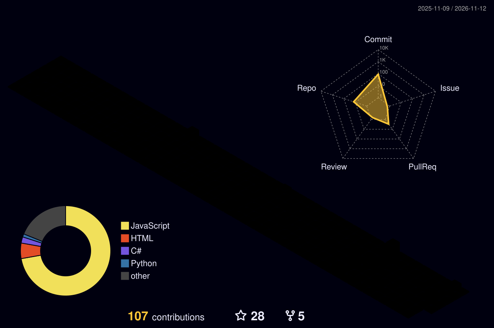

<div align="center">
  <h1>👋 Hey, I'm Mithlesh Prasad</h1>
  <h3>💻 Software Engineer | 🚀 Founder @ MpxHR | 🏗️ ERP & SaaS Developer</h3>
  
  
</div>

<br/>

<div align="center">
  <h3>🌐 Connect With Me</h3>
  <a href="https://www.linkedin.com/in/mithlesh-prasad-5a68a41a3/" target="_blank">
    
  </a>
  <a href="https://www.mpxhr.com/" target="_blank">
    
  </a>
  <a href="https://github.com/mithleshprasad" target="_blank">
    
  </a>
</div>

---

### ⚡ About Me

```javascript
const mithlesh = {
  role: "Software Engineer",
  company: "Murphy Lightings",
  founder: "MpxHR",
  specialization: [
    "Enterprise ERP",
    "Full Stack Development",
    "Business Automation",
    "SaaS Product Development"
  ],
  technologies: {
    frontend: ["React", "Redux", "JavaScript", "TypeScript"],
    backend: ["Node.js", "Express", "Socket.IO"],
    database: ["MySQL", "MongoDB", "SQLite", "Redis"],
    devops: ["Git", "Docker", "AWS", "Nginx"]
  },
  currentFocus: "Building scalable ERP & SaaS solutions"
};
```

---

<h2 align="center">🚀 Featured Projects</h2>

<div align="center">
  <a href="https://www.mpxhr.com/" target="_blank">
    
  </a>
</div>

<br/>

### 🔹 MpxHR Enterprise — Offline-First HRMS for Indian MSMEs
- 👥 **Employee Management & Compliance**
- 📍 **Biometric Attendance & Leave Management**
- 💰 **1-Click Payroll & Automated Payslip Generation**
- 📊 **Custom Reports & Business Analytics**
- 🔒 **High Security Offline-First Desktop Application**
- 🌐 **Website:** [https://www.mpxhr.com](https://www.mpxhr.com)

### 🔹 Murphy ERP — Enterprise Business Automation Platform
- ⚙️ **End-to-End Enterprise Architecture:** Purchase | Sales | Inventory | Production | HRMS | Accounts
- 🔄 **Integrations:** Tally Prime Synchronization & AI-driven business analytics

---

<h2 align="center">🛠️ Tech Stack</h2>

<div align="center">
  
</div>

---

<h2 align="center">📊 GitHub Analytics</h2>

<div align="center">
  
  
</div>

<br/>

<div align="center">
  
</div>

---

<h2 align="center">🌌 3D Contribution Graph</h2>

<div align="center">
  
</div>

---

<h2 align="center">🐍 Contribution Animation</h2>

<div align="center">
  
</div>

<br/>

<div align="center">
  <p>💡 <b>Building the Future Through Code</b><br/><i>Build. Innovate. Automate.</i></p>
  
</div>
